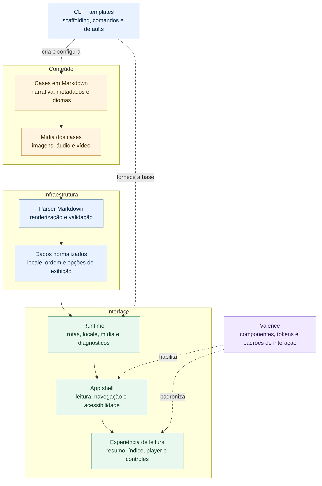

<!-- config
{
  // Identity
  "id": "portfoliable",
  "caseOrder": 100,
  "slugByLocale": {
    "en": "template-case",
    "pt": "template-case",
    "he": "template-case"
  },
  "socialImage": {
    "en": "https://images.unsplash.com/photo-1518770660439-4636190af475?q=80&w=1200&h=675&auto=format&fit=contain&bg=111111",
    "pt": "https://images.unsplash.com/photo-1518770660439-4636190af475?q=80&w=1200&h=675&auto=format&fit=contain&bg=111111",
    "he": "https://images.unsplash.com/photo-1518770660439-4636190af475?q=80&w=1200&h=675&auto=format&fit=contain&bg=111111"
  },

  // Localized Metadata
  "title": {
    "show": true,
    "en": "Making Portfoliable",
    "pt": "Criando Portfoliable",
    "he": "Making Portfoliable"
  },
  "shortDesc": {
    "show": true,
    "en": "An open-source, markdown-first portfolio builder for clear, maintainable case studies.",
    "pt": "Um construtor de portfólios open source e markdown-first para cases claros e fáceis de manter.",
    "he": "An open-source, markdown-first portfolio builder for clear, maintainable case studies."
  },
  "readTime": {
    "en": "3 min",
    "pt": "3 min",
    "he": "3 min"
  },
  "kicker": {
    "en": "2026",
    "pt": "2026",
    "he": "2026"
  },

  // Thumbnail and Cover
  "thumbSrc": {
    "en": "src/content/cases/portfoliable/en-cover.avif",
    "pt": "src/content/cases/portfoliable/cover.avif",
    "he": "src/content/cases/portfoliable/en-cover.avif"
  },
  "thumbCategory": "desktop",
  "thumbBrand": "apple",
  "thumbModel": "Apple MacBook Air M5",
  "thumbColor": "MacBook Air M5 15-inch Sky Blue",
  "showCover": false,

  // Summary Experience (config-driven)
  "showSummary": true,
  "summary": {
    "en": "Portfoliable turns a portfolio into a small, content-driven product: structured enough to scale, simple enough to keep writing.",
    "pt": "O Portfoliable transforma o portfólio em um pequeno produto orientado a conteúdo: estruturado para crescer, simples para continuar escrevendo.",
    "he": "Portfoliable turns a portfolio into a small, content-driven product: structured enough to scale, simple enough to keep writing."
  },
  "summaryProps": {
    "text": {
      "en": "A reusable runtime, a CLI workflow, and a reader experience designed for hiring conversations.",
      "pt": "Um runtime reutilizável, um fluxo via CLI e uma experiência de leitura pensada para conversas de contratação.",
      "he": "A reusable runtime, a CLI workflow, and a reader experience designed for hiring conversations."
    },
    "active": true,
    "labelHeader": {
      "en": "Case Snapshot",
      "pt": "Resumo do case",
      "he": "Case Snapshot"
    },
    "showMetrics": true,
    "ariaLabel": {
      "en": "Case summary with key metrics",
      "pt": "Resumo do case com métricas-chave",
      "he": "Case summary with key metrics"
    },
    "metrics": [
      {
        "value": "7",
        "label": {
          "en": "Accessibility modes",
          "pt": "modos de acessibilidade"
        },
        "variant": "default",
        "ariaLabel": {
          "en": "Seven global accessibility modes, including large text, high contrast, reduced motion, and forced colors",
          "pt": "Sete modos globais de acessibilidade, incluindo texto grande, alto contraste, movimento reduzido e cores forçadas"
        }
      },
      {
        "value": "13",
        "label": {
          "en": "Keyboard shortcuts",
          "pt": "atalhos de teclado"
        },
        "variant": "default",
        "ariaLabel": {
          "en": "Thirteen keyboard shortcuts for navigation, search, language, reading, and accessibility",
          "pt": "Treze atalhos de teclado para navegação, busca, idioma, leitura e acessibilidade"
        }
      },
      {
        "value": "4",
        "label": {
          "en": "Engineering surfaces",
          "pt": "superfícies de engenharia"
        },
        "variant": "default",
        "ariaLabel": {
          "en": "Four connected surfaces: initializer, runtime, templates, and documentation",
          "pt": "Quatro superfícies conectadas: initializer, runtime, templates e documentação"
        }
      },
      {
        "value": "2",
        "label": {
          "en": "Locale workflows",
          "pt": "fluxos de localização"
        },
        "variant": "default",
        "ariaLabel": {
          "en": "Two built-in locale workflows: add and remove languages",
          "pt": "Dois fluxos nativos de locale: adicionar e remover idiomas"
        }
      },
      {
        "value": "100%",
        "label": {
          "en": "Markdown-driven",
          "pt": "orientado a Markdown"
        },
        "variant": "default",
        "ariaLabel": {
          "en": "Content authored in markdown",
          "pt": "Conteúdo escrito em Markdown"
        }
      }
    ]
  },

  // Reader Experience
  "showReader": true,
  "showToc": true,
  "showNavigator": true,

  // Audio Experience
  "audioLabel": {
    "en": "Case Audio Summary",
    "pt": "Case Audio Summary",
    "he": "Case Audio Summary"
  },
  "audioSrc": {
    "en": "src/content/cases/template-case/template-audio.mp3",
    "pt": "src/content/cases/template-case/template-audio.mp3",
    "he": "src/content/cases/template-case/template-audio.mp3"
  },
  "showPlayer": false,

  // Visibility and Protection
  "visibility": {
    "web": true,
    "crawlers": true,
    "ai": true,
    "locales": {}
  },
  "isProtected": false,
  "isUnlocked": false,

  // Social
  "social": {
    "share": {
      "enabled": true,
      "icon": "share",
      "icon-variant": "outline",
      "tooltip": {
        "en": "Share this case link",
        "pt": "Compartilhar o link deste case",
        "he": "Share this case link"
      }
    },
    "linkedin": {
      "enabled": true,
      "icon": "linkedin",
      "icon-variant": "outline",
      "tooltip": {
        "en": "Share on LinkedIn",
        "pt": "Compartilhar no LinkedIn",
        "he": "Share on LinkedIn"
      }
    },
    "x": {
      "enabled": true,
      "icon": "x",
      "icon-variant": "outline",
      "tooltip": {
        "en": "Share on X",
        "pt": "Compartilhar no X",
        "he": "Share on X"
      }
    },
    "facebook": {
      "enabled": true,
      "icon": "facebook",
      "icon-variant": "outline",
      "tooltip": {
        "en": "Share on Facebook",
        "pt": "Compartilhar no Facebook",
        "he": "Share on Facebook"
      }
    },
    "links": {
      "linkedin": "",
      "x": "",
      "facebook": ""
    }
  },

  // Actions
  "actions": {
    "primary": {
      "enabled": false,
      "variant": "primary",
      "icon": "",
      "icon-variant": "",
      "label": {
        "en": "Watch presentation",
        "pt": "Assistir à apresentação",
        "he": "Watch presentation"
      },
      "tooltip": {
        "en": "Open walkthrough video",
        "pt": "Abrir o vídeo de apresentação",
        "he": "Open walkthrough video"
      },
      "url": {
        "en": "",
        "pt": "",
        "he": ""
      },
      "videoSrc": {
        "en": "",
        "pt": "",
        "he": ""
      },
      "vttSrc": {
        "en": "",
        "pt": "",
        "he": ""
      },
      "imageAlt": {
        "en": "",
        "pt": "",
        "he": ""
      },
      "ariaLabel": {
        "en": "",
        "pt": "",
        "he": ""
      }
    },
    "secondary": {
      "enabled": true,
      "variant": "secondary",
      "icon": "",
      "icon-variant": "",
      "label": {
        "en": "Repository",
        "pt": "Repositório",
        "he": "Repository"
      },
      "tooltip": {
        "en": "Open repo on GitHub",
        "pt": "Abrir o repositório no GitHub",
        "he": "Open repo on GitHub"
      },
      "url": {
        "en": "https://github.com/portfoliablejs/portfoliable",
        "pt": "https://github.com/portfoliablejs/portfoliable",
        "he": "https://github.com/portfoliablejs/portfoliable"
      },
      "imageAlt": {
        "en": "",
        "pt": "",
        "he": ""
      },
      "ariaLabel": {
        "en": "",
        "pt": "",
        "he": ""
      }
    },
    "tertiary": {
      "enabled": true,
      "variant": "tertiary",
      "label": {
        "en": "Visit website",
        "pt": "Visitar o site",
        "he": "Visit website"
      },
      "tooltip": {
        "en": "Get to know this project",
        "pt": "Conhecer este projeto",
        "he": "Get to know this project"
      },
      "url": {
        "en": "https://www.portfoliable.js.org/",
        "pt": "https://www.portfoliable.js.org/",
        "he": "https://www.portfoliable.js.org/"
      },
      "has-image": false,
      "image-src": "",
      "image-alt": "",
      "imageAlt": {
        "en": "",
        "pt": "",
        "he": ""
      },
      "ariaLabel": {
        "en": "",
        "pt": "",
        "he": ""
      }
    }
  },

  // Custom Buttons
  "customButtons": [],
}
-->

<!-- lang:en -->
# Portfoliable: a portfolio that behaves like a product

Portfoliable is an open-source portfolio builder for people who want to present complex work without first building a publishing system. The central idea is simple: **the portfolio should support the story, not become another project to maintain**.

## The opportunity

Most portfolio tools optimize for getting a page online. That is useful for a landing page, but case studies need more: a clear narrative, enough structure for a quick scan, and enough flexibility to explain decisions honestly. They also need to survive real constraints—multiple languages, responsive layouts, accessibility preferences, media assets, and future edits.

Portfoliable treats those constraints as part of the product. A case is authored as a versioned Markdown file, paired with localized metadata. The runtime turns that source into a reader experience with summaries, table of contents, navigation, media, sharing controls, and sensible defaults.

> The author owns the content. The system takes care of the ceremony.

[INSERIR IMAGEM 1 — Hero do produto: um print amplo do case aberto no navegador, mostrando título, resumo executivo e o primeiro bloco de conteúdo. Use uma composição limpa, com bastante espaço em branco, para comunicar “produto pronto” antes dos detalhes técnicos.]

## From blank folder to publishable case

The fastest path is deliberately practical:

```bash
npm create portfoliable@latest my-portfolio
cd my-portfolio
npm run portfoliable-create-case -- --name "My first case"
```

From there, the workflow stays close to how teams already work:

1. Define the case metadata and language variants.
2. Write the narrative in Markdown.
3. Preview the generated app locally.
4. Validate content and build when it is ready to ship.

This separation is important. The **CLI scaffolds the repeatable work**, while the content file remains the source of truth. A designer can focus on the story; a developer can inspect a predictable project structure, run the same checks, and extend the runtime without rewriting every page.

The case configuration stays explicit and easy to review:

```json
{
  "id": "checkout-revamp",
  "title": {
    "en": "Checkout Revamp",
    "pt": "Redesign do checkout"
  },
  "showSummary": true,
  "showToc": true,
  "showNavigator": true
}
```

The result is a useful boundary between content and behavior: the Markdown explains **what** happened, while configuration declares **how** the case should be presented.

## A small system with clear boundaries

Under the hood, Portfoliable is organized around a few focused layers:

| Layer | Responsibility |
| --- | --- |
| Case Markdown | Narrative, localized sections, and case-specific metadata |
| Runtime | Routing, parsing, reader behavior, media, sharing, and validation |
| CLI and templates | Project scaffolding, repeatable commands, and safe defaults |
| Valence | Reusable UI components, tokens, and accessible interaction patterns |

Valence appears here as an enabling layer, not the headline: it gives the runtime a consistent visual and interaction vocabulary, so features such as summaries, headers, thumbnails, players, and controls can evolve without every case inventing its own UI.

[INSERIR IMAGEM 2 — Arquitetura: um diagrama simples com “Markdown cases” alimentando “Parser + Runtime”, que por sua vez usa “CLI/Templates” e “Valence”. Destaque as fronteiras entre conteúdo, infraestrutura e interface; evite um diagrama cheio de nomes internos.]

Localization is also part of the content model rather than a separate application. A single file can keep parallel sections while the parser selects the right one at runtime:

```markdown
&lt;!-- lang:en --&gt;
## The outcome
The new flow reduced friction and made the decision easier to explain.

&lt;!-- lang:pt --&gt;
## O resultado
O novo fluxo reduziu atrito e tornou a decisão mais fácil de explicar.
```

## Designed for reading, not just browsing

The reader experience is where the technical decisions become visible. A case can expose a summary for a recruiter who has thirty seconds, a table of contents for someone doing a deeper review, and navigation controls for moving between projects. Localized routes and metadata keep the same work legible across languages instead of duplicating an entire application.

Accessibility is treated as a product requirement: contrast and motion preferences, keyboard-friendly controls, readable content width, semantic headings, and explicit labels are part of the runtime contract. The goal is not to add an accessibility checklist at the end, but to make the comfortable path the default path.

[INSERIR IMAGEM 3 — Experiência de leitura: uma tela dividida ou sequência de dois prints mostrando o mesmo case em inglês e português, com o seletor de idioma, índice lateral e controles de acessibilidade visíveis. O foco deve ser a continuidade da experiência, não apenas a tradução.]

For a technical reader, the key is that these features compose rather than compete:

```js
const caseView = {
  content: parseMarkdown(caseFile),
  locale: resolveLocale(requestedLanguage),
  reader: {
    summary: true,
    tableOfContents: true,
    navigator: true
  }
};
```

That composition keeps the reader experience consistent across cases, while leaving each project free to tell a different story.

## What I learned building it

The most useful decision was to keep the authoring surface small while making the runtime responsible for consistency. Markdown is approachable, Git makes changes reviewable, and a structured config block carries the information that should not be hidden inside prose. That combination creates a productive tension: authors get freedom where it matters, while the system can still validate what must be reliable.

The trade-off is intentional. Portfoliable is opinionated about structure, naming, and defaults; it is not trying to be a universal CMS. In return, a new case can be created quickly, content can be localized without a second codebase, and the same reader patterns can be improved centrally.

### The result

- **A faster starting point:** one command creates the project and its conventions.
- **A stronger narrative layer:** cases are structured for scanning and depth.
- **A maintainable implementation:** runtime behavior, templates, and docs have clear ownership.
- **A more inclusive default:** language, accessibility, and reading comfort are considered from the first render.

Portfoliable is both a tool I use to publish work and a case study about product thinking in infrastructure. It turns a portfolio from a one-off page into a small, versioned product—without asking the author to become a full-time webmaster.

Explore the [Portfoliable website](https://www.portfoliable.js.org/) or the [open-source repository](https://github.com/portfoliablejs/portfoliable).

<!-- lang:pt -->
O Portfoliable é um construtor de portfólios open source em JavaScript para quem precisa apresentar trabalhos complexos sem construir um sistema de publicação. A ideia central é simples: **o portfólio deve sustentar a história, não virar mais um projeto para manter**.

## A oportunidade

A maioria das ferramentas de portfólio otimiza o caminho até uma página publicada. Isso resolve uma landing page, mas um case precisa de mais: uma narrativa clara, estrutura suficiente para uma leitura rápida e flexibilidade para explicar decisões com honestidade. Também precisa lidar com restrições reais — múltiplos idiomas, layouts responsivos, acessibilidade, mídia e futuras edições.

O Portfoliable trata essas restrições como parte do produto. Cada case é escrito em um arquivo Markdown versionado e acompanhado de metadados localizados. O runtime transforma essa fonte em uma experiência de leitura com resumo, índice, navegação, mídia, compartilhamento e boas configurações padrão.

> A pessoa autora cuida do conteúdo. O sistema cuida da cerimônia.


<figure style="width: 55%; margin-inline: auto;">
  
</figure>

## Da pasta vazia ao case publicável

O caminho mais rápido é deliberadamente prático:

```bash
npm create portfoliable@latest meu-portfolio
cd meu-portfolio
npm run portfoliable-create-case -- --name "Meu primeiro case"
```

A partir daí, o fluxo fica próximo do trabalho real de uma equipe:

1. Definir os metadados e as variações de idioma.
2. Escrever a narrativa em Markdown.
3. Visualizar o app gerado localmente.
4. Validar o conteúdo e fazer o build quando estiver pronto para publicar.

Essa separação é importante. A **CLI cria o trabalho repetível**, enquanto o arquivo de conteúdo continua sendo a fonte de verdade. Uma pessoa de design pode se concentrar na história; uma pessoa de desenvolvimento encontra uma estrutura previsível, executa as mesmas verificações e estende o runtime sem reescrever cada página.

A configuração do case continua explícita e fácil de revisar:

```json
{
  "id": "checkout-revamp",
  "title": {
    "en": "Checkout Revamp",
    "pt": "Redesign do checkout"
  },
  "showSummary": true,
  "showToc": true,
  "showNavigator": true
}
```

Assim, existe uma fronteira útil entre conteúdo e comportamento: o Markdown explica **o que** aconteceu, enquanto a configuração declara **como** o case deve ser apresentado.

## Um sistema pequeno, com fronteiras claras

Por baixo da interface, o Portfoliable se organiza em algumas camadas focadas:

| Camada | Responsabilidade |
| --- | --- |
| Markdown dos cases | Narrativa, seções localizadas e metadados específicos |
| Runtime | Rotas, parsing, leitura, mídia, compartilhamento e validação |
| CLI e templates | Scaffolding, comandos repetíveis e defaults seguros |
| Valence | Componentes reutilizáveis, tokens e padrões de interação acessíveis |

O Valence aparece aqui como uma camada habilitadora, não como protagonista: ele oferece ao runtime um vocabulário visual e de interação consistente. Assim, resumos, headers, thumbnails, players e controles podem evoluir sem que cada case invente sua própria interface.



A localização também faz parte do modelo de conteúdo, em vez de ser uma segunda aplicação. Um único arquivo mantém seções paralelas enquanto o parser seleciona a versão correta em runtime:

```markdown
&lt;!-- lang:en --&gt;
## The outcome
The new flow reduced friction and made the decision easier to explain.

&lt;!-- lang:pt --&gt;
## O resultado
O novo fluxo reduziu atrito e tornou a decisão mais fácil de explicar.
```

## Feito para ler, não apenas navegar

A experiência de leitura é onde as decisões técnicas ficam visíveis. Um case pode oferecer um resumo para quem tem trinta segundos, um índice para uma avaliação mais profunda e controles de navegação para passar de um projeto a outro. Rotas e metadados localizados mantêm o mesmo trabalho legível em diferentes idiomas, sem duplicar uma aplicação inteira.

A acessibilidade é tratada como requisito de produto: contraste e preferência de movimento, controles operáveis pelo teclado, largura confortável de leitura, headings semânticos e labels explícitos fazem parte do contrato do runtime. A intenção não é adicionar um checklist no fim, mas tornar o caminho confortável o caminho padrão.

[INSERIR IMAGEM 3 — Experiência de leitura: uma tela dividida ou sequência de dois prints mostrando o mesmo case em inglês e português, com seletor de idioma, índice lateral e controles de acessibilidade visíveis. O foco deve ser a continuidade da experiência, não apenas a tradução.]

Para quem está lendo tecnicamente, o ponto principal é que esses recursos são compostos, e não competem entre si:

```js
const caseView = {
  content: parseMarkdown(caseFile),
  locale: resolveLocale(requestedLanguage),
  reader: {
    summary: true,
    tableOfContents: true,
    navigator: true
  }
};
```

Essa composição mantém a experiência consistente entre cases, sem impedir que cada projeto conte uma história diferente.

## O que aprendi construindo

A decisão mais útil foi manter pequena a superfície de autoria e deixar o runtime cuidar da consistência. Markdown é acessível, Git torna as mudanças revisáveis e um bloco de configuração estruturado guarda o que não deveria ficar escondido na prosa. Essa combinação cria uma tensão produtiva: quem escreve tem liberdade onde ela importa, enquanto o sistema valida o que precisa ser confiável.

A troca é intencional. O Portfoliable tem opiniões sobre estrutura, nomenclatura e defaults; ele não tenta ser um CMS universal. Em troca, um novo case nasce rápido, o conteúdo pode ser localizado sem uma segunda base de código e os mesmos padrões de leitura podem melhorar de forma centralizada.

### O resultado

- **Um começo mais rápido:** um comando cria o projeto e suas convenções.
- **Uma narrativa mais forte:** os cases são estruturados para leitura rápida e aprofundamento.
- **Uma implementação sustentável:** runtime, templates e documentação têm responsabilidades claras.
- **Um default mais inclusivo:** idioma, acessibilidade e conforto de leitura entram desde a primeira renderização.

O Portfoliable é, ao mesmo tempo, uma ferramenta para publicar trabalho e um case sobre pensar em produto ao construir infraestrutura. Ele transforma o portfólio de uma página isolada em um pequeno produto versionado — sem exigir que a pessoa autora vire webmaster em tempo integral.

Conheça o [site do Portfoliable](https://www.portfoliable.js.org/) ou o [repositório open source](https://github.com/portfoliablejs/portfoliable).

<!-- lang:he -->
## Context
Add localized context in he.

## Outcome
Add localized outcome in he.
